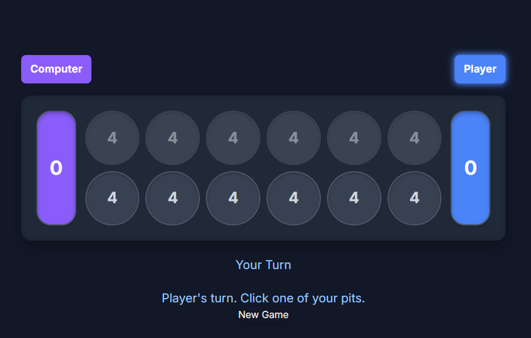

# Mancala Game: Enhanced Edition

A classic Mancala board game implemented with modern web technologies, featuring enhanced AI, accessibility, and modular architecture. This project showcases professional JavaScript development practices with comprehensive testing and documentation.

Play the game live on GitHub Pages: [https://yaredwb.github.io/mancala_game/](https://yaredwb.github.io/mancala_game/)

## 🌟 New Features & Improvements

### ✨ **Enhanced AI Strategy**
- Multi-factor move evaluation system
- Strategic planning beyond simple seed counting
- Configurable difficulty levels (Easy, Normal, Hard)

### ♿ **Full Accessibility Support**
- ARIA labels and semantic HTML
- Keyboard navigation (Tab, Enter, Space)
- Screen reader compatibility
- WCAG 2.1 compliance

### ⚡ **Performance Optimizations**
- Element caching and selective DOM updates
- Efficient rendering during animations
- Optimized event handling

### 🔧 **Configurable Game Settings**
- Customizable seed counts and animation speeds
- Preset configurations (Classic, Quick, Challenge)
- Flexible game rules adaptation

### 📦 **Modular Architecture**
- Organized into separate, maintainable modules
- Clear separation of concerns
- Professional code documentation

### 🧪 **Testing Infrastructure**
- Comprehensive test suite with 7 test cases
- Interactive test runner
- Quality assurance validation

## Preview



## Features

* **Player vs. Computer:** Play against a computer opponent.
* **Classic Mancala Board:** Standard layout with 6 pits per player and one store (Mancala) each.
* **Simplified Rules:**
    * Seeds are sown one by one in a counter-clockwise direction.
    * Player's seeds skip the opponent's store.
    * No extra turns for landing in your own store.
    * No capture rule for landing in an empty pit.
* **Turn-Based Gameplay:** Clear indication of whose turn it is.
* **Seed Sowing Animation:** Visual feedback as seeds are distributed.
* **Game Over Detection:** Automatically detects when one side has no more seeds in their pits.
* **Final Score Calculation:** Remaining seeds are collected, and the winner is declared.
* **Responsive Design:** Adapts to different screen sizes for play on desktop and mobile devices.
* **Modern UI:** Clean and intuitive interface with a dark theme.
* **"New Game" Functionality:** Easily restart the game at any time.

## How to Play

1.  **Objective:** Collect more seeds in your Mancala (store) than your opponent.
2.  **Board Setup:** The game starts with 4 seeds in each of the 12 smaller pits. The player's pits are on the bottom row, and their Mancala is the large store to their right. The computer's pits are on the top row, and its Mancala is the large store to its left.
3.  **Your Turn:**
    * Click on one of your 6 pits that contains seeds.
    * All seeds from that pit are picked up.
    * Starting from the next pit to the right (counter-clockwise), one seed is dropped into each subsequent pit.
    * If sowing passes over your own Mancala, a seed is dropped into it.
    * Sowing *skips* the opponent's Mancala.
4.  **Computer's Turn:** The computer will automatically make its move after you.
5.  **Game End:** The game ends when all 6 pits on one player's side are empty. The player who still has seeds on their side of the board collects all of those seeds into their Mancala.
6.  **Winner:** The player with the most seeds in their Mancala at the end of the game wins.

## Technologies Used

* **HTML:** Structure of the game.
* **CSS (Tailwind CSS):** Styling for the modern look and feel, and responsiveness.
* **JavaScript:** Game logic, player interaction, AI, and DOM manipulation.
* **Google Fonts (Inter):** For modern typography.

## Accessing the Game

You can play the enhanced game directly in your web browser:

[**🎮 Play Mancala Game on GitHub Pages**](https://yaredwb.github.io/mancala_game/)

### **Local Development**
```bash
# Clone the repository
git clone https://github.com/yaredwb/mancala_game.git

# Navigate to the project directory
cd mancala_game

# Start local development server
npm run dev
# or
python3 -m http.server 8000

# Open browser to http://localhost:8000
```

### **Running Tests**
```bash
# Open tests.html in browser or visit:
# http://localhost:8000/tests.html
```

### **Custom Configuration**
```javascript
// Create game with custom settings
const game = new MancalaGame({
    INITIAL_SEEDS_PER_PIT: 6,
    SOWING_SPEED: 150,
    AI_DIFFICULTY: 'hard'
});

// Or use presets
const quickGame = new MancalaGame(GameConfig.createPreset('quick'));
```

## Code Structure

The project is now organized into a modular architecture for better maintainability:

### **File Organization**
* **`index.html`** - Main game interface with semantic HTML and accessibility features
* **`css/styles.css`** - Separated stylesheet with responsive design
* **`js/config.js`** - Game constants and configuration
* **`js/gameConfig.js`** - Configurable game settings and presets
* **`js/ai.js`** - Enhanced AI strategy engine
* **`js/renderer.js`** - DOM manipulation and rendering optimization
* **`js/game.js`** - Main game engine with error handling
* **`js/main.js`** - Application entry point
* **`tests.html`** - Interactive test suite
* **`package.json`** - Project configuration and dependencies

### **Key Classes and Functions**
* **`MancalaGame`** - Main game controller with configurable settings
* **`MancalaAI`** - Enhanced AI with strategic move evaluation
* **`GameRenderer`** - Optimized DOM manipulation with element caching
* **`GameConfig`** - Flexible configuration system with validation
* **Test Suite** - Comprehensive testing with 7 test cases

### **Architecture Benefits**
* **Maintainable**: Clear separation of concerns
* **Testable**: Comprehensive test coverage
* **Accessible**: Full WCAG 2.1 compliance
* **Performant**: Optimized rendering and caching
* **Configurable**: Flexible game settings and presets

## Future Enhancements

The enhanced architecture provides a solid foundation for additional features:

### **Immediate Opportunities**
* Advanced AI with minimax algorithm
* Player vs. Player mode
* Game history and undo functionality
* Sound effects and enhanced animations
* Multiple visual themes

### **Advanced Features**
* Online multiplayer capabilities
* Tournament mode and statistics tracking
* Mobile app development
* Save/load game states
* Achievement system

For detailed technical improvements, see [IMPROVEMENTS.md](IMPROVEMENTS.md).

---

*This enhanced Mancala game showcases modern JavaScript development practices with professional code organization, comprehensive testing, and accessibility compliance.*
